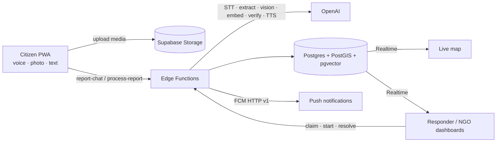

# Awaaz — آواز

**Your voice. Your neighbourhood. · آپ کی آواز، آپ کا محلہ**

Awaaz is a voice-first, AI-verified community map. Anyone — including people who cannot read — reports a local problem
by **talking**, snapping a photo or typing. AI turns each report into a categorised, verified pin on a live map and
alerts the right responder: Rescue 1122, fire brigade, police, the water authority, shelters, food banks and health NGOs.

- **Live app:** https://awaaz.avezea.com (installable PWA)
- **Team AVEZEA:** Muhammad Ahsan · Muhammad Bilal
- **Event:** Build with Google Hackathon · GDGoC CUI (COMSATS University Islamabad), Fall 2026

---

## What it does

| | |
|---|---|
| 🎙️ **Talk to AI, not a form** | The citizen speaks (Urdu, Roman Urdu, Punjabi or English). The AI asks at most 3 short spoken follow-up questions, each with big icon buttons to tap instead of talking, and collects structured details: urgency (Emergency / Urgent / Can wait), people affected, injuries, children at risk, since when, road blocked, landmark — plus category-specific ones (flood depth, people trapped, food servings…). Emergencies skip the questions and send immediately. |
| 🗺️ **Live map** | One pin per incident, colour + icon by category, status ring (Unconfirmed → Verified → In progress → Resolved), report count. Updates in real time. |
| ✅ **AI verification** | Reports of the same issue are linked even in different languages (same category within 300 m / 6 h + multilingual embeddings). Independent reporters, confirm/dispute votes and a photo-vs-claim check produce a confidence score and a one-line reason. Every AI output is labelled **AI-assessed**. |
| 🚑 **Routing to responders** | Approved organisations register a service area and categories; each incident goes to the nearest matching ones (high/critical immediately, even before verification — clearly marked). Responders get a push notification, then **claim → start → resolve**; the citizen sees every status change. |
| 🛡️ **Women's safety SOS** | Silent mode (vibration only). Start it by holding the SOS button, pressing a volume button 3×, shaking the phone, or the app-icon shortcut. It listens in 8-second chunks; on a threat ("maar dunga", "jaan se maar", "bachao", "I'll kill you"…) the nearest police get a private alert with live location and audio evidence. Never shown on the public map; logged in the user's own SOS log. |
| 🍲 **Food rescue** | A caterer photographs leftover food → AI estimates food type and servings → a safe-until countdown starts → the nearest shelter and food bank are alerted and claim the pickup. |
| 🔊 **Built for people who can't read** | Voice guidance clips in Urdu and English on every key screen, icons and colour over text, Urdu right-to-left UI, large tap targets, silence/too-short recordings detected with a spoken "we couldn't hear you", works on low-cost Android phones. |
| 📱 **Onboarding** | Language → phone number → on-screen demo SMS code (tap to fill) → one spoken question ("your name and area") → the AI reads your profile back to you for trust. |
| 📶 **Offline** | Reports are saved on the phone without internet and sent automatically when back online. |
| 🧭 **Area digest** | "What's happening near me?" — a short bilingual AI summary of nearby issues, read aloud. Responders get a daily AI summary. |
| 🖥️ **Admin console** | Everything in one place: KPIs, 14-day trend, live map (including private SOS), reports with transcripts and voice notes, users, organisations, assignments, SOS sessions, notifications. |

## UN Sustainable Development Goals

One shared pipeline — **speak → understand → verify → route → resolve** — serves many domains, so each new domain only
needs a category and a responder. Awaaz contributes to:

| SDG | Targets | How |
|---|---|---|
| 1 No Poverty | 1.5 | Faster help for the poorest households in floods and emergencies |
| 2 Zero Hunger | 2.1 | Surplus food routed to shelters and food banks |
| 3 Good Health | 3.6, 3.d | Hazards and health emergencies reported and routed in seconds |
| 5 Gender Equality | 5.2 | Silent SOS with threat detection and police alerts |
| 6 Clean Water & Sanitation | 6.1, 6.2 | Water outages, contamination, open manholes |
| 9 Industry, Innovation & Infrastructure | 9.1, 9.c | Infrastructure faults surfaced; ICT access via voice |
| 10 Reduced Inequalities | 10.2 | Usable without reading, in local languages |
| 11 Sustainable Cities | 11.1, 11.5, 11.7 | Basic services, disaster resilience, safe public spaces |
| 12 Responsible Consumption | 12.3 | Less food waste |
| 13 Climate Action | 13.1 | Urban flooding reports and early routing |
| 16 Peace, Justice & Strong Institutions | 16.1, 16.6, 16.7, 16.10 | Less violence; accountable, responsive services; public information |
| 17 Partnerships | 17.17 | Citizens, NGOs and public responders on one platform |

---

## Tech stack

| Layer | Technology | Used for |
|---|---|---|
| Frontend | **React 19 + Vite 8 + TypeScript + Tailwind CSS 4** | Mobile-first PWA (vite-plugin-pwa: manifest, installable, service worker, offline app shell) |
| Hosting | **Vercel** | Production at `awaaz.avezea.com` |
| Database | **Supabase Postgres + PostGIS + pgvector** | Reports, clusters, organisations; geo queries (`ST_DWithin`, `ST_Covers`); vector similarity for duplicate matching; Row-Level Security on every table |
| Backend logic | **Supabase Edge Functions (Deno)** — 11 functions | `process-report`, `report-chat`, `voice-profile`, `vote`, `verify-report`, `route-report`, `notify-nearby`, `assignment-action`, `sos`, `tts`, `digest` |
| Realtime | **Supabase Realtime** | Live pins, responder dashboards, status changes, SOS live location |
| Auth & storage | **Supabase Auth + Storage** | Email, anonymous (phone-style onboarding) and role-based accounts; voice notes, photos, cached speech |
| AI (core) | **OpenAI** | Speech-to-text, understanding, conversation, vision, embeddings, verification, text-to-speech (see below) |
| AI (Google) | **Google Gemini** | `gemini-3.8-flash` and `gemini-3.5-flash-lite` registered per task in the model registry (`models.ts`), with the API key held in Edge Function secrets |
| Push | **Firebase Cloud Messaging** (HTTP v1) | Web push to responders, NGOs and citizens; same service worker as the PWA |
| Maps | **Leaflet + OpenStreetMap** | Live incident map, clustering, service-area circles, location picking |
| Geocoding | **OpenStreetMap Nominatim** (Google Geocoding when a server key is set) | Turning spoken or typed places ("Street 5, G-9/4") into map points |

### Architecture



## AI usage (disclosure)

All AI runs server-side in Supabase Edge Functions; no AI keys are in the browser or the repo. Every AI-generated
output in the UI carries an **AI-assessed** label, and people stay in control: responders decide, citizens confirm or
dispute, admins can override.

| Task | Model | Why |
|---|---|---|
| Speech-to-text (Urdu / Punjabi / English voice notes) | OpenAI `gpt-transcribe` | Multi-language hints for code-switched speech |
| Report understanding → strict JSON (category, urgency, bilingual summary, location hints, spam flag, attributes) | OpenAI `gpt-6-luna` | Fast, low-cost structured outputs |
| AI intake conversation (follow-up questions + quick replies) | OpenAI `gpt-6-luna` (streamed) | Low latency so the voice reply starts quickly |
| Photo check (does the photo match the claim, severity, food type + servings) | OpenAI `gpt-6.1-terra` | Visual reasoning |
| Duplicate matching across languages | OpenAI `text-embedding-3-large` (1536 dims) | Strong multilingual similarity, fits pgvector HNSW |
| Verification confidence + one-line reason | OpenAI `gpt-6-luna` | Guard-railed around a transparent heuristic (± 0.15) |
| SOS threat detection | OpenAI `gpt-6-luna` + keyword rules | Rules work even if AI fails; AI catches paraphrases |
| Voice profile extraction (name, area, language) | OpenAI `gpt-6-luna` | Spoken onboarding |
| Text-to-speech (questions, read-backs, digests) | OpenAI `gpt-4o-mini-tts` | Natural Urdu and English voices; cached in Storage |
| Area digest + daily responder summary | OpenAI `gpt-6-luna` | Short bilingual summaries |
| Model registry entries for speech, understanding, vision and summaries | Google `gemini-3.8-flash` / `gemini-3.5-flash-lite` | Registered per task alongside the OpenAI models in `models.ts` |

All model IDs live in one file: [`supabase/functions/_shared/models.ts`](supabase/functions/_shared/models.ts);
thresholds in [`_shared/config.ts`](supabase/functions/_shared/config.ts).

**Privacy:** the public map is served from a view without reporter IDs; SOS incidents are private to the alerted police
and admins; voice notes are in a private bucket.

---

## Run it locally

Requirements: Node 24, Supabase CLI, a Supabase project, an OpenAI key, a Firebase project (Cloud Messaging).

```bash
npm install
cp .env.example .env.local        # fill the VITE_* values (public, browser)
npm run dev
```

Backend (Supabase):

```bash
supabase link --project-ref <your-ref>
supabase db push                                   # schema, RLS, RPCs, storage, realtime
supabase secrets set --env-file supabase/functions/.env   # OPENAI_API_KEY, GEMINI_API_KEY, APP_URL
supabase secrets set FIREBASE_SERVICE_ACCOUNT_JSON="$(cat service-account.json)"
supabase functions deploy --use-api
node scripts/seed.mjs                              # demo users, organisations and city data
node scripts/gen-voice-prompts.mjs                 # Urdu + English voice-guide clips
```

Environment variables are documented in [`.env.example`](.env.example). Server secrets live only in Supabase Edge
Function secrets.

### End-to-end demo check

```bash
node scripts/demo-e2e.mjs
```

Runs the four demo steps against the live backend: Urdu voice note + photo → High Hazard pin (Unconfirmed, routed to
Rescue 1122) → English text joins the same pin → Verified → Rescue 1122 claims and resolves → citizen sees Resolved →
caterer's food photo → ~120 servings + safe-until → shelter alerted and claims.

### Demo logins

Use the one-tap buttons on `/login`. All demo accounts share the `DEMO_PASSWORD` constant in
[`src/lib/demoAccounts.ts`](src/lib/demoAccounts.ts). These are sample partner accounts — there is no real government
integration.

| Account | Role |
| --- | --- |
| `rescue1122@awaaz.demo` | Rescue 1122 |
| `fire@awaaz.demo` | Fire Brigade |
| `police@awaaz.demo` | Police (receives SOS alerts) |
| `water@awaaz.demo` | Water & Sanitation Authority |
| `shelter@awaaz.demo` | Shelter NGO |
| `foodbank@awaaz.demo` | Food Bank NGO |
| `health@awaaz.demo` | Health NGO |
| `admin@awaaz.demo` | Admin console |
| `citizen1@awaaz.demo` … `citizen5@awaaz.demo` | Citizens |

### SOS limitation

Browsers deliver hardware volume keys only on some Android devices and only while the app is open in the foreground.
Triggering SOS with the screen off or the app in the background needs a native wrapper (TWA + Android service) — on the
roadmap.

## Roadmap

Real SMS OTP · native Android wrapper for background SOS triggers · official integrations with Rescue 1122 and city
helplines · Pashto, Sindhi and Saraiki voices · trusted-contact alerts · open data and planning analytics for
municipalities · more cities.
